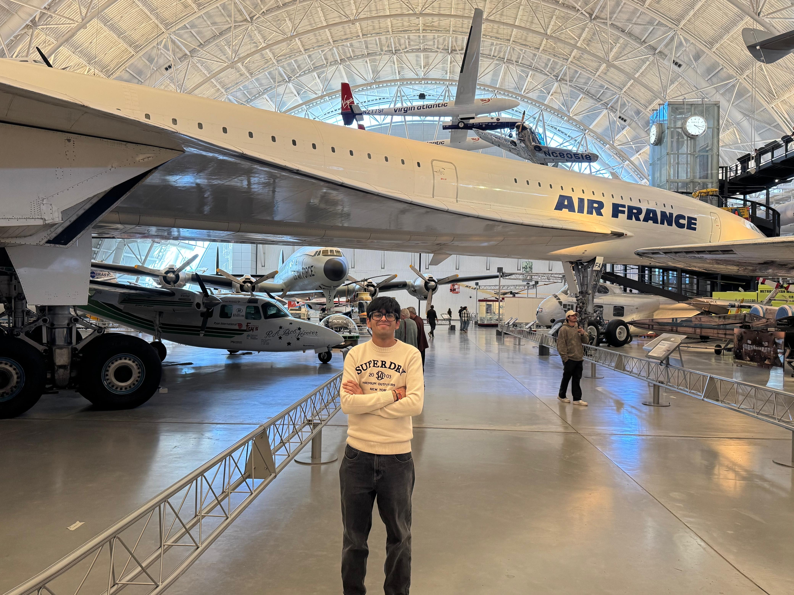

**By:** Shivam Parti

I am a junior at Georgetown University's School of Foreign Service studying International Economics. I am fascinated by antitrust and competition, intellectual property dynamics, and academic economics. I enjoy learning about AI developments and technology policy. Aviation is another one of my passions. This project mixes my interests and serves as a study done both for class and my own intellectual curiosity.

[Read the story](story.qmd)

{fig-align="center" width="60%}