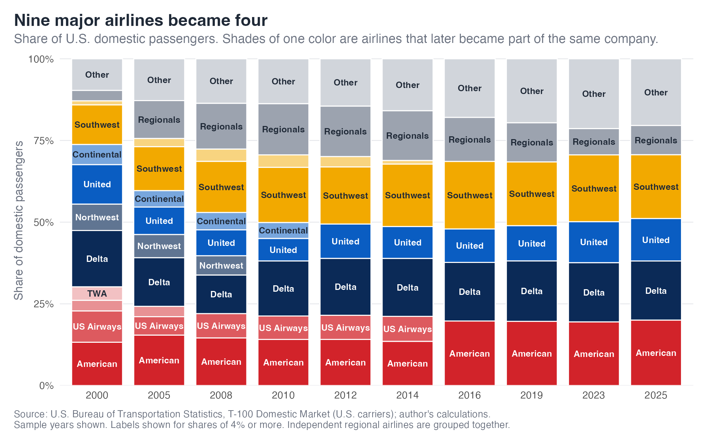
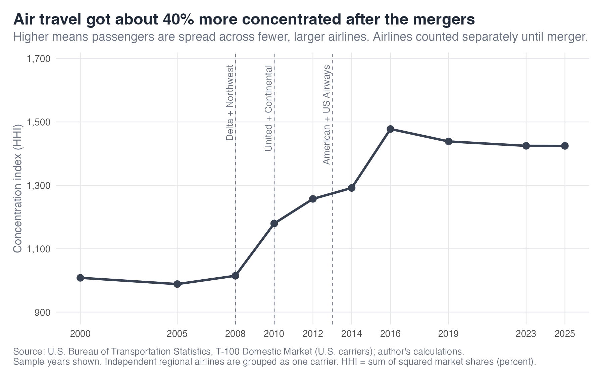
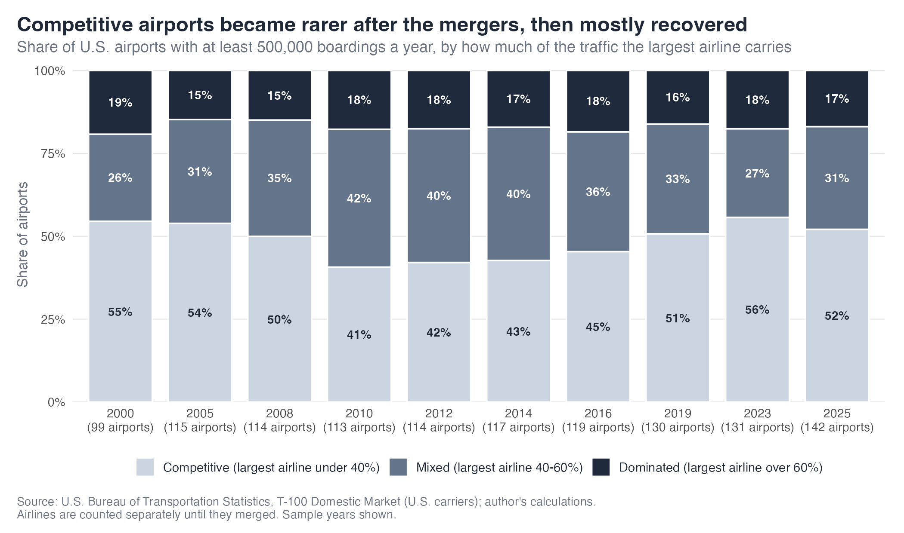
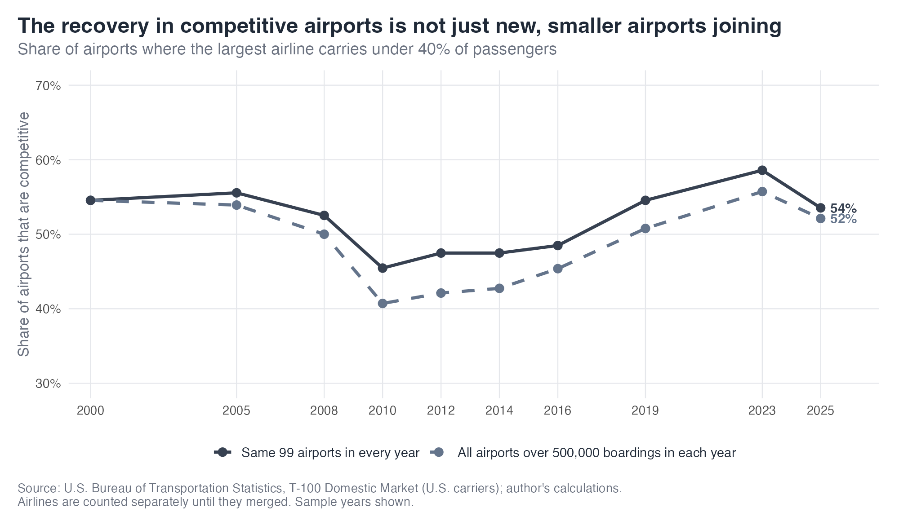

Most of us only critique the U.S. aviation industry while at the airport. We notice how every single gate is branded with just one airline and the dearth of air carrier options at airports. Often, we feel that fares are too high relative to the quality of service provided. In the United States, both the authorities and the populace have shown apathy towards support for what can prevent such situations: competition. When several airlines fight for the same passengers, they have an incentive to cut fares, add flights, and maintain a standard of customer service. Conversely, when there are fewer players who dominate, they gain greater influence over price setting.

Between 2008 and 2013, the three biggest mergers in modern U.S. aviation history were finalized: Delta with Northwest, United with Continental, and American with U.S. Airways.[^1] Each merger removed a competitor from the market. In this analysis, I will investigate whether these mergers led to a dangerous level of concentration in the airline industry, as defined by conventional economic indices.

To conduct my analysis, I used public data from the U.S. Bureau of Transportation Statistics about the U.S. domestic air passenger market for ten sample years between 2000 and 2025. Firstly, examining market shares:

{#fig-share fig-alt="Stacked bars of airline shares of U.S. passengers, 2000 to 2025"}

Immediately looking at @fig-share, you can notice how many names disappear. In 2000, the bar contained eight major airlines: American, US Airways, TWA, Delta, Northwest, United, Continental, and Southwest. Following the bars from left to right, you can watch the mergers happen and the shades of a color coalesce into one. The market share, or the percentage of bar that is one shade, goes up for the merged entities.

By 2025, four airlines (American, Delta, United and Southwest) carried roughly 70% of all domestic passengers. Yet, the "Other" band at the top of the bar has also grown; this suggests that smaller carriers too gained ground in this period. So, was this enough to offset the consolidation?

## Too Big to Fly?

In antitrust economics, a common index used to measure whether a market is concentrated is called the Herfindahl-Hirschman Index (HHI). HHI measures market concentration by taking the market share of every firm in an industry, squaring each percentage, and adding them together.[^2] The resulting score ranges from near zero for a highly competitive market up to 10,000 for a total monopoly, with higher numbers indicating less competition and greater pricing power for top dominant players.[^3] Under the 2010 federal antitrust guidelines, a market with an HHI below 1,500 is considered unconcentrated, 1,500 to 2,500 is moderately concentrated, and above 2,500 is highly concentrated.[^4] The updated 2023 DOJ/FTC guidelines lower the highly concentrated line to 1,800, where mergers increasing HHI by over 100 points face strong regulatory scrutiny.[^5]

{#fig-hhi fig-alt="Line chart of national airline concentration, 2000 to 2025"}

Looking at the airline industry, @fig-hhi shows the national score barely moving for the first 8 years. It sits near 1,000 in the year 2000, dips slightly in 2005, and is still around 1,010 in 2008. The dashed lines mark the three mergers and the line bends upwards after the first such line. By 2010, the index sat around 1,180, and by 2014 after the American-US Airways merger, it climbed to 1,290. It increased further to 1,480 in 2016. This is nearly 50% above where it started.

After that, the line goes flat. Between 2019 and 2025, it held at roughly 1,420 to 1,440, though it was still substantially higher than in 2000. So, while the airline industry did not cross the 1,500-index threshold to be classified as moderately concentrated, the mergers themselves raised the index by roughly 450 points, indicating the need for scrutiny.

So, was there a governmental inquiry? Federal regulators such as the Department of Justice (DOJ) pushed back only minimally in the case of Delta-Northwest, stating that the pair had little direct route overlap; so, the concentration would not lead to consumer harm. In the case of United-Continental, United was required to hand over 36 airport slots to Southwest to address competitive concerns.[^6] However, the American-US Airways merger faced heavy scrutiny from the DOJ. The eventual result was a settlement where the merger was allowed to go through only after American agreed to airport gate and slot divestitures to low-cost carriers.[^7]

## Trouble at the Terminal

The national numbers therefore suggest a mixed result. However, using the national market broadly can hide competitive harm in specific airports that carry a large proportion of passengers. To know whether mergers caused harmful effects in significant sectors or airports, I filtered the list to U.S. airports with at least 500,000 boardings a year by how much of their traffic the largest airline carries; I designated under 40% as competitive, 40-60% as mixed, and over 60% as dominated.

{#fig-dominance fig-alt="Bars showing the share of airports by level of dominance by the largest airline"}

@fig-dominance yields a different pattern from the national trend. In 2000, 55% of airports were competitive, but by 2010 that share fell to 41%. The percentage of airports in the "Mixed" and "Dominated" categories increased at the same time as the first two mergers.

Yet, the competitive share climbed back up to 45% in 2016, 51% in 2019, and 56% in 2023, a number even higher than in 2000. It sat at 52% in 2025. Additionally, the share of airports in the "Dominated" category remains stable, indicating that the mergers did not spur a series of airport monopolies. They pushed many airports to the mixed zone in the short term, with the industry recovering over time. One important caveat to note is that the sample grew from 99 to 142 airports between 2000 and 2025, as the number of airports that crossed 500,000 annual boardings increased. So, you could question if the recovery reflects smaller, more competitive airports entering the sample. To test this, I held the 99 initial airports in my sample constant.

{#fig-dominance-fixed fig-alt="Line chart comparing the share of competitive airports in a fixed sample of 99 airports and in all large airports, 2000 to 2025"}

In @fig-dominance-fixed, the competitive share in the fixed sample moves from 55% in 2000 to 54% in 2025, so the recovery is not explained by new airports entering the sample. Because the fixed sample removes the effect of airports growing past the 500,000-boarding cutoff, it is the cleaner test of whether competition truly recovered.

::: {#fig-bonus}

```{=html}
<iframe src="figures/07_airport_migration_bonus.html" width="100%" height="690" style="border:0;" title="Bonus graphic: the same 99 airports from 2000 to 2025, sorted by the largest airline's share of passengers" onload="try{this.style.height=(this.contentWindow.document.querySelector('.wrap').scrollHeight+4)+'px'}catch(e){}"></iframe>
```

Bonus graphic: AI-assisted visualization. The same 99 airports followed from 2000 to 2025, sorted by the largest airline's share of passengers.

:::

If you wish to follow which of the 99 initial airports with over 500,000 boardings recovered and which ones worsened, you can do so through this AI-assisted graphic. This will show the evolution of market concentration at the airports, allowing you to check how the mergers affected them and if they recovered.

## Mapping the Concentration

```{=html}
<iframe src="figures/04_airport_map_interactive.html" width="100%" height="680" style="border:0;" title="Map of the largest airline's share of passengers at U.S. airports, by year"></iframe>
```

On this map, each circle represents an airport. Its size grows with the number of passengers that board aircraft there annually. The gradient shows the concentration at these airports by tracking the share carried by the largest airline. The darker the gray, the higher the dominance of a single airline. Adjusting the slider or pressing play shows the evolution of concentration over the years.

In 2000, many of the biggest hub airports are colored in deep gray. Some examples include Atlanta (Delta, 73%), Minneapolis (Northwest, 72%), St. Louis (TWA, 74%), Pittsburgh (US Airways, 86%), and Cincinnati (Delta, 95%). Adjusting the time of analysis, the richly-colored spots mostly remain so. Hub concentration was already high before mergers, and it remained high after them.

## Big Airport = More Competition?

```{=html}
<iframe src="figures/05_size_vs_dominance_interactive.html" width="100%" height="760" style="border:0;" title="Scatter plot of airport size against the largest airline's share, by year"></iframe>
```
On this scatterplot, each dot represents an airport. The horizontal axis shows its yearly boardings on a log scale, so each step to the right is a relatively big jump in size. The vertical axis shows the largest airline's share. The color of the dot indicates the largest airline, with silver dots indicating a regional mix. I have added a horizontal cutoff where an airline carries half of all passengers at the airport.

Intuitively, one might think that larger airports would be more competitive, since there would be greater room for competition. But the chart complicates this assumption. In 2000, some busy airports, such as Charlotte (10 million boardings) or Atlanta (36 million boardings), sit high on the chart. At these airports, one airline carried 90% and 73% of all passengers respectively. Yet, some other airports, such as Los Angeles and New York-La Guardia, sit much lower at around 30%. Size alone does not predict dominance. Instead, "hub" status is critical—concentration is high at airports used by airlines as a connecting point between two different places. Airlines often use the "hub and spoke" model where they connect smaller regional airports to larger airports for improved international connectivity. This model can create concentration in large airports.[^8]

## Check Your Boarding Pass

```{=html}
<iframe src="figures/06_hub_explorer_interactive.html" width="100%" height="760" style="border:0;" title="Stacked area chart of airline shares at a chosen airport"></iframe>
```

By this point, I am sure you are curious about how your airport has done over time. Using the menu, you can select one of the twenty-two busiest airports in the United States and see which airline (if any) dominated it, and how that changed over time.

## Final Approach

Taken together, the figures and analysis tell a nuanced story. Nationally, the industry consolidated from eight major carriers to just four, and HHI concentration rose by about 40%. Many airports got pushed out of the competitive category, yet a lot recovered the lost competition. Overall, the number of dominated airports remained roughly the same. The U.S. airline industry remains top-heavy, with smaller carriers filling in the edges. Many busy hubs were controlled by one airline before and after the mergers.

The analysis also has some limitations. It measures passengers, not price or service quality. A concentrated market can still have low prices, and a competitive one can still have bad service quality. Therefore, it is hard to say whether consumer welfare was impacted. Secondly, I am using sample years. Importantly, I do not use years most affected by the COVID-19 pandemic: 2020–2022. Doing the analysis involved a tradeoff between including these years in which the aviation industry underwent a structural break and dropping certain years. Thirdly, an airport-level view hides the pattern for individual routes. Two cities can have competitive airports and still be served by only one airline, meaning de facto market power is high but hidden.

Nonetheless, the results tell us that across the United States, where you live shapes what airline you can fly. If you live in Charlotte or Atlanta, you effectively do not have a say in what carrier you can choose. Yet, in Los Angeles or Fort Lauderdale, you are served by a variety of airlines. In sum, the structure of the aviation industry across the United States is highly disparate.

## Bibliography

Steinbaum, Marshall. *Airline Consolidation, Merger Retrospectives, and Oil Price Pass-Through*. Roosevelt Institute, March 29, 2018. <https://rooseveltinstitute.org/wp-content/uploads/2020/07/RI-Airline-Consolidation-201806.pdf>.

U.S. Department of Justice. Antitrust Division. "Herfindahl-Hirschman Index." Updated January 17, 2024. <https://www.justice.gov/atr/herfindahl-hirschman-index>.

U.S. Department of Justice. "Justice Department Requires US Airways and American Airlines to Divest Facilities at Seven Key Airports to Enhance System-wide Competition and Settle Merger Challenge." November 12, 2013. <https://www.justice.gov/archives/opa/pr/justice-department-requires-us-airways-and-american-airlines-divest-facilities-seven-key>.

U.S. Department of Justice. "United Airlines and Continental Airlines Transfer Assets to Southwest Airlines in Response to Department of Justice's Antitrust Concerns." August 27, 2010. <https://www.justice.gov/archives/opa/pr/united-airlines-and-continental-airlines-transfer-assets-southwest-airlines-response>.

U.S. Department of Justice and Federal Trade Commission. *Horizontal Merger Guidelines*. 2010. <https://www.ftc.gov/sites/default/files/attachments/mergers/100819hmg.pdf>.

U.S. Department of Justice and Federal Trade Commission. *Merger Guidelines*. 2023. <https://www.ftc.gov/system/files/ftc_gov/pdf/2023_merger_guidelines_final_12.18.2023.pdf>.

U.S. General Accounting Office. *Airline Competition: Higher Fares and Reduced Competition at Concentrated Airports*. GAO/RCED-90-102. Washington, DC: U.S. General Accounting Office, July 11, 1990. <https://www.gao.gov/assets/rced-90-102.pdf>.

[^1]: Marshall Steinbaum, *Airline Consolidation, Merger Retrospectives, and Oil Price Pass-Through* (Roosevelt Institute, March 29, 2018), abstract, <https://rooseveltinstitute.org/wp-content/uploads/2020/07/RI-Airline-Consolidation-201806.pdf>.

[^2]: U.S. Department of Justice, Antitrust Division, "Herfindahl-Hirschman Index," updated January 17, 2024, <https://www.justice.gov/atr/herfindahl-hirschman-index>.

[^3]: U.S. Department of Justice, "Herfindahl-Hirschman Index."

[^4]: U.S. Department of Justice and Federal Trade Commission, *Horizontal Merger Guidelines* (2010), § 5.3, 19, <https://www.ftc.gov/sites/default/files/attachments/mergers/100819hmg.pdf>.

[^5]: U.S. Department of Justice and Federal Trade Commission, *Merger Guidelines* (2023), § 2.1, 5, <https://www.ftc.gov/system/files/ftc_gov/pdf/2023_merger_guidelines_final_12.18.2023.pdf>.

[^6]: U.S. Department of Justice, "United Airlines and Continental Airlines Transfer Assets to Southwest Airlines in Response to Department of Justice's Antitrust Concerns," August 27, 2010, <https://www.justice.gov/archives/opa/pr/united-airlines-and-continental-airlines-transfer-assets-southwest-airlines-response>.

[^7]: U.S. Department of Justice, "Justice Department Requires US Airways and American Airlines to Divest Facilities at Seven Key Airports to Enhance System-wide Competition and Settle Merger Challenge," November 12, 2013, <https://www.justice.gov/archives/opa/pr/justice-department-requires-us-airways-and-american-airlines-divest-facilities-seven-key>.

[^8]: U.S. General Accounting Office, *Airline Competition: Higher Fares and Reduced Competition at Concentrated Airports*, GAO/RCED-90-102 (Washington, DC: U.S. General Accounting Office, July 11, 1990), 12, <https://www.gao.gov/assets/rced-90-102.pdf>.